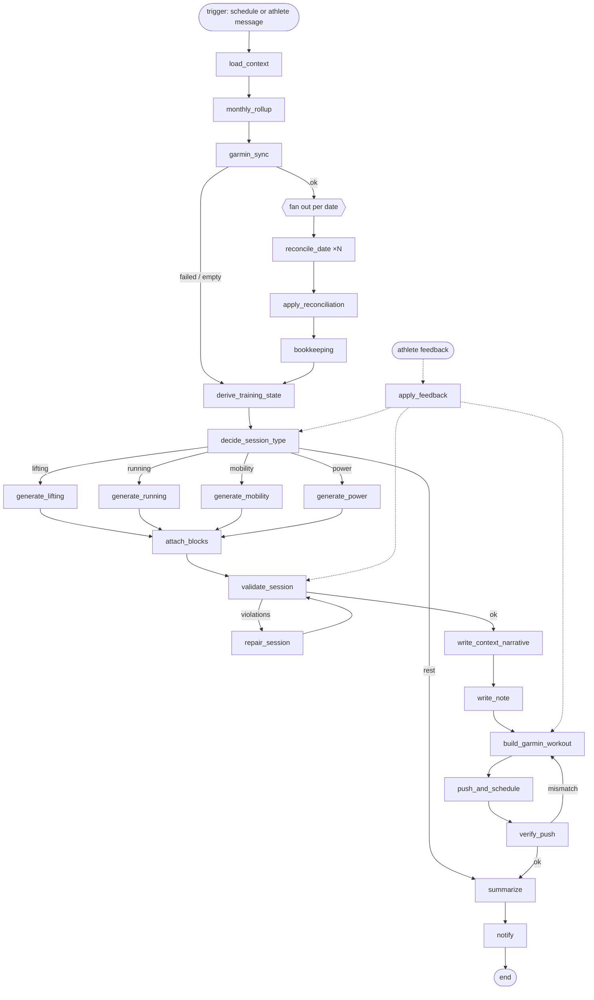

# Lift-and-Run — Library Architecture

> Architecture for turning the current prompt-driven daily workout loop into a Python library orchestrated with LangGraph. Synthesized 2026-10-02 from the live system: [workout-loop.md](file:///Users/erevtsov/Library/Mobile%20Documents/iCloud~md~obsidian/Documents/personal-synced/Scripts/workout-loop.md), the program modules under `Scripts/programs/` ([strength-running-hybrid](file:///Users/erevtsov/Library/Mobile%20Documents/iCloud~md~obsidian/Documents/personal-synced/Scripts/programs/strength-running-hybrid.md), [531](file:///Users/erevtsov/Library/Mobile%20Documents/iCloud~md~obsidian/Documents/personal-synced/Scripts/programs/531.md), [running-vdot](file:///Users/erevtsov/Library/Mobile%20Documents/iCloud~md~obsidian/Documents/personal-synced/Scripts/programs/running-vdot.md), [mobility](file:///Users/erevtsov/Library/Mobile%20Documents/iCloud~md~obsidian/Documents/personal-synced/Scripts/programs/mobility.md)), [garmin_sync.py](file:///Users/erevtsov/Library/Mobile%20Documents/iCloud~md~obsidian/Documents/personal-synced/Scripts/garmin_sync.py), [garmin_workout.py](file:///Users/erevtsov/Library/Mobile%20Documents/iCloud~md~obsidian/Documents/personal-synced/Scripts/garmin_workout.py), and the exercise-log notes under `Areas/health/_exercise_log/`. Everything below that describes *behavior* is extracted from those files and from real runs — not invented. Sections marked **Proposed** are new design.
>
> **Scope extended 2026-10-02:** three disciplines — strength, endurance, and **power/explosiveness** — instead of two. The power component and the generalizations it forces are in §17 (all **Proposed**; nothing about power exists in the live system yet). "lift-and-run" is a working name until a final one is picked.

---

## 1. What exists today

A Claude scheduled routine fires each morning with a short prompt that defers to `workout-loop.md`. Claude then reads markdown "modules," reasons through rules written in prose, shells into the Mac via Desktop Commander to run Python, and edits vault notes by hand.

| Piece                        | Role today                                                                                                                                                                                   | Problem it causes                                                                |
| ---------------------------- | -------------------------------------------------------------------------------------------------------------------------------------------------------------------------------------------- | -------------------------------------------------------------------------------- |
| `workout-loop.md`            | Program-agnostic procedure: Step 0 rollup → Step 1 Garmin sync → Step 2 reconciliation → Step 3 generate → Step 4 push → summary. Also holds the Equipment list and Injury/Modification Log. | Rules are prose; every run re-interprets them.                                   |
| `strength-running-hybrid.md` | Scheduler: decides lift / run / mobility / rest via rotation + overrides + fatigue + tie-break.                                                                                              | Rotation state is re-derived from notes by reading paragraphs of past reasoning. |
| `531.md`                     | Lifting program: TMs, percentages, lift priority, accessory pools, rotation rules, note template, Garmin specifics, cycle history.                                                           | TM math and accessory rotation are done "by hand" each run.                      |
| `running-vdot.md`            | Running module: VDOT, pace table, run-type alternation, volume progression, Current State table.                                                                                             | Current State is a hand-edited markdown table.                                   |
| `mobility.md`                | Mobility routine, template, Garmin pose list.                                                                                                                                                | —                                                                                |
| `garmin_sync.py`             | Fetch-only: activities (+ run lap splits) and a same-day wellness snapshot as JSON.                                                                                                          | Fine as-is; becomes an adapter.                                                  |
| `garmin_workout.py`          | Shared Garmin workout-building helpers, persistent workout IDs, push/schedule, and (since 2026-10-02) the `EXERCISE_SUBSTITUTIONS` registry.                                                 | Build scripts are typed into a REPL each day.                                    |
| Exercise-log notes           | One note per training day; the de facto database.                                                                                                                                            | No machine-readable state beyond frontmatter.                                    |

The core insight from running this for weeks: **almost every decision is a deterministic rule, and almost every bug came from re-deriving that rule by hand.** The library's job is to move rules into code and keep the LLM for narrative, ambiguity, and athlete conversation.

---

## 2. Design principles (each one earned by a real incident)

1. **Rules in code, judgment in the LLM.** Rotation, overrides, TM math, pace tables, accessory rotation, reconciliation classification — deterministic functions with tests. The LLM writes the Context paragraph, classifies genuinely ambiguous activities, weighs borderline wellness signals, and parses athlete feedback.
2. **One source of truth per fact.** The cable-machine substitution survived for weeks because "check recent notes" was the lookup mechanism (fixed 2026-10-02 with `EXERCISE_SUBSTITUTIONS`). Same pattern for workout IDs, pace tables, TMs, equipment.
3. **Verify against the real world, not against yourself.** A kg/lb bug round-tripped "consistently" through the API while rendering wrong on the watch. Verification compares against known real values (e.g. `weightValue ≈ 130` for a 130 lb set; pace bounds decode back to the intended min/mile), never only self-consistency.
4. **Idempotent side effects.** Re-generating a day must never duplicate a Garmin calendar entry (`clear_scheduled_workouts` before `schedule_workout`), and re-running reconciliation must not re-append sections.
5. **Never destroy real data.** Only fill blanks, append sections, or apply the two sanctioned destructive rules (mismatch-regenerate, no-show delete). Planned weights are not "real data"; logged sets are.
6. **Append-only history.** Program/module/scheduler activation tables, cycle history, VDOT history, injury log — rows are never deleted.
7. **Pluggable programs.** The loop must not change when 5/3/1 is swapped for another program, or VDOT for another running scheme.
8. **Equipment is a hard constraint everywhere** — exercise selection *and* the Garmin label pushed to the watch.
9. **Garmin access only from the Mac.** No cloud-sandbox calls; the cached session lives in `Scripts/.garmin_session/`.
10. **The run is only as good as its notification.** Unattended runs end with a push summary; silence means nothing worth knowing.

---

## 3. Domain model

All models are pydantic. The vault stays the system of record; these are parsed from and serialized to notes.

### 3.1 Athlete (program-agnostic)

```python
class Equipment(BaseModel):
    items: set[str]            # power_rack, pullup_bar, dip_station, flat_bench, barbells,
                               # adjustable_dumbbell (x1), resistance_bands, landmine, plates
    forbidden: set[str]        # cable_machine, multi_station_machine, second_dumbbell, adjustable_bench

class InjuryEntry(BaseModel):  # append-only; mirrors workout-loop.md's Injury/Modification Log
    date: date
    issue: str
    affected: set[str]         # e.g. {"running", "squat", "deadlift", "hip_hinge_accessories"}
    modification: str
    resolved: date | None

class Athlete(BaseModel):
    equipment: Equipment
    injuries: list[InjuryEntry]
    def active_restrictions(self, on: date) -> set[str]: ...
```

### 3.2 Session note (the shared frontmatter schema)

Every note: `date, type (lifting|running|mobility|cardio), phase, cycle, week, main_lift, completed, energy, sleep_hours, bodyweight`. Modules may add fields (`run_type`; generic cardio adds `distance_miles, duration, avg_pace, avg_hr, source`) but never remove them.

Conventions encoded as invariants:
- Path: `Areas/health/_exercise_log/{YYYY}/{YYYY-MM-DD}.md`; prior months live in `{YYYY}/Q{n}/`.
- **Rest day = no note.** Never write a placeholder.
- `week` on a non-lifting day = the *upcoming* program week.
- `completed: true` on a lifting day only when a Garmin `strength_training` activity's name matches `main_lift`.
- Sections are typed: `Context`, `Warm-up`, lift tables, `Plan`, `Actual`, `Actual (2) — <name> (<HH:MM>)`, `Notes`, `Garmin Push`, `Garmin Data`.

### 3.3 Garmin data (from `garmin_sync.py`)

```python
class Split(BaseModel):
    lap: int; distance_miles: float; duration: str; avg_pace: str
    avg_hr: float | None; intensity: Literal["WARMUP","ACTIVE","RECOVERY","COOLDOWN","REST","INTERVAL"]

class Activity(BaseModel):
    date: date; start_time_local: datetime; activity_id: int; name: str
    type: str                  # running | strength_training | yoga | golf | ...
    distance_miles: float | None; duration: str; avg_pace: str | None
    avg_hr: float | None; max_hr: float | None; calories: float | None
    splits: list[Split] = []

class Wellness(BaseModel):    # same-day snapshot only; every field may be None = "no signal"
    sleep_score: int | None; sleep_hours: float | None
    hrv_last_night: float | None; hrv_weekly_avg: float | None; hrv_status: str | None
    training_readiness_score: int | None; training_readiness_level: str | None
    resting_hr: float | None; body_battery_min: int | None; body_battery_max: int | None
```

### 3.4 Derived training state (computed, never hand-maintained)

```python
class TrainingState(BaseModel):
    today: date
    last_lift: SessionRef | None          # last *actual* lift (Garmin-confirmed or logged)
    last_run: SessionRef | None
    last_mobility: SessionRef | None
    lifts_since_last_run: int
    rotation_slot: Literal["lower","upper","run","rest_mobility"]   # pending slot
    next_lift_group: Literal["lower","upper"]                       # lower/upper alternation
    program: ProgramState                 # owned by the active lifting program
    running: RunningState                 # owned by the active running module
    wellness: Wellness | None
    restrictions: set[str]                # from Athlete.active_restrictions(today)
```

`TrainingState` replaces the "read 14 days of Context paragraphs and re-derive" step. It is built from frontmatter + Garmin activities only, so it cannot drift from prose.

---

## 4. Plugin interfaces

The current markdown "Active Program / Active Running Module / Active Hybrid Scheduler" records become a config file with the same append-only history.

```python
class Scheduler(Protocol):
    def decide(self, s: TrainingState) -> SessionDecision: ...       # type + reasons[]

class LiftingProgram(Protocol):
    name: str
    def state(self, history: list[SessionNote]) -> ProgramState: ...
    def pick_lift(self, s: TrainingState) -> Lift: ...
    def generate(self, s: TrainingState, lift: Lift) -> LiftingSession: ...
    def is_heavy_lower(self, note: SessionNote) -> bool: ...          # for run adjacency
    def is_deload(self, s: TrainingState) -> bool: ...
    def close_cycle(self, s: TrainingState) -> CycleResult | None: ...  # TM progression

class RunningModule(Protocol):
    def state(self, history: list[SessionNote]) -> RunningState: ...
    def pick_run_type(self, s: TrainingState, quality_allowed: bool) -> RunType: ...
    def generate(self, s: TrainingState, run_type: RunType) -> RunningSession: ...
    def record(self, activity: Activity) -> None: ...                 # Current State bookkeeping

class MobilityModule(Protocol):
    def is_due(self, s: TrainingState) -> bool: ...                   # weekly; never skip 2 weeks
    def generate(self, s: TrainingState) -> MobilitySession: ...

class GarminWorkoutBuilder(Protocol):   # one per session kind
    def build(self, session: Session) -> GarminWorkout: ...
    def verify(self, fetched: dict, session: Session) -> list[VerificationError]: ...
```

Shipping implementations (ported from the current modules):

| Slot | Implementation | Source |
| --- | --- | --- |
| Scheduler | `StrengthRunningHybrid` | strength-running-hybrid.md |
| LiftingProgram | `FiveThreeOneTriumvirateFSL` | 531.md |
| RunningModule | `VdotRunning` | running-vdot.md |
| MobilityModule | `WeeklyMobility` | mobility.md |
| PowerModule | `PowerPrimer` | **Proposed** — see §17 |

With a third discipline, a plugin is no longer just "owns a session type." Each discipline declares two capabilities: `session()` (it can own a whole day) and `blocks()` (it can attach a short block to another discipline's day). Lifting and running mostly own sessions; power mostly attaches blocks; mobility does both (weekly session, plus warm-up staples). See §17.2.

---

## 5. The LangGraph daily graph (Proposed)

### 5.1 Shape



### 5.2 Graph state

```python
class LoopState(TypedDict):
    run_id: str
    today: date
    trigger: Literal["schedule", "feedback"]
    config: LoopConfig                         # active scheduler/program/modules, vault path
    athlete: Athlete
    activities: list[Activity]
    wellness: Wellness | None
    sync_status: Literal["ok", "failed", "empty"]
    notes: dict[date, SessionNote]             # loaded window (today-14 .. today)
    reconciliation: Annotated[list[ReconAction], operator.add]   # reducer: fan-in from Send
    rollup_moves: list[tuple[Path, Path]]
    training: TrainingState | None
    decision: SessionDecision | None           # type + ordered reasons (rule ids)
    session: Session | None                    # structured lift/run/mobility plan
    violations: list[Violation]
    note_path: Path | None
    garmin: GarminResult | None                # workout_id, device, scheduled date, verification
    feedback: list[AthleteFeedback]
    log: Annotated[list[LogEvent], operator.add]
    summary: str | None
```

### 5.3 Nodes

| Node                      | Kind                | Does                                                                                                        | Notes                                                                                  |
| ------------------------- | ------------------- | ----------------------------------------------------------------------------------------------------------- | -------------------------------------------------------------------------------------- |
| `load_context`            | det.                | Load config, athlete (equipment, injury log), notes for last 14 days.                                       | Fails loudly if the vault path is unreachable.                                         |
| `monthly_rollup`          | det.                | Move loose prior-month notes into `{YYYY}/Q{n}/`.                                                           | Idempotent; records moves for the summary; rewrites backlinks if any.                  |
| `garmin_sync`             | I/O                 | `fetch(days=7)` → activities + wellness.                                                                    | On failure sets `sync_status="failed"` and **continues** — never blocks generation.    |
| `reconcile_date`          | det. + LLM fallback | Classify one date's (note, activities) pair into a `ReconAction` (§6).                                      | Fanned out with `Send` per date; LLM only for `ambiguous`.                             |
| `apply_reconciliation`    | I/O                 | Execute actions: fill, append, regenerate, delete, unschedule.                                              | Every write is diffed and logged; destructive ones only from the two sanctioned rules. |
| `bookkeeping`             | det.                | Running Current State, program per-set data (e.g. AMRAP reps pulled from Garmin), cycle close-out.          | Runs before derive so today's decision sees fresh state.                               |
| `derive_training_state`   | det.                | Build `TrainingState` from notes + activities.                                                              | Pure function — the main unit-test target.                                             |
| `decide_session_type`     | det. + LLM          | Run scheduler rules (§7); LLM only for borderline wellness.                                                 | Emits rule ids, e.g. `["override.lift_gt_2d", "tiebreak.none"]`.                       |
| `generate_*`              | det.                | Program/module produces a structured session.                                                               | No prose here.                                                                         |
| `attach_blocks` | det. | Ask every other discipline for blocks that fit today's session (e.g. power primer before a lift, strides after an easy run); order them by the in-session rule (§17.3). | A block that fails a constraint is dropped, not repaired. |
| `validate_session`        | det.                | Equipment, injury restrictions, accessory/core rotation, run adjacency, substitution registry coverage.     | Hard failures → `repair_session`.                                                      |
| `repair_session`          | det. → LLM          | Swap the offending element using the program's pools; LLM only if pools are exhausted.                      | Bounded retries (3).                                                                   |
| `write_context_narrative` | LLM                 | The `> Context` block: rotation reasoning, which lift and why, wellness, injuries, "also on the radar."     | Input is the rule trace + state; the LLM explains, it does not decide.                 |
| `write_note`              | I/O                 | Render template + narrative to markdown.                                                                    | Refuses to overwrite a note containing logged sets.                                    |
| `build_garmin_workout`    | det.                | Builder per session kind (§8).                                                                              | Applies `EXERCISE_SUBSTITUTIONS`.                                                      |
| `push_and_schedule`       | I/O                 | Update persistent workout, push to Epix, clear + schedule calendar.                                         | Epix only.                                                                             |
| `verify_push`             | det.                | Re-fetch; check weights in plain lb, pace bounds, distances, substitution descriptions, one calendar entry. | Mismatch → rebuild (max 2), then fail the run.                                         |
| `summarize`               | LLM                 | Daily Output Summary (sync freshness, reconciled notes, today's session + why, push result).                |                                                                                        |
| `notify`                  | I/O                 | Push notification with `<routine_summary>` when something happened; silent otherwise.                       |                                                                                        |
| `apply_feedback`          | LLM → det.          | Parse athlete messages into typed edits (§9) and re-enter the graph at the right node.                      |                                                                                        |

### 5.4 Checkpointing and human-in-the-loop

- **Checkpointer:** SQLite at `Scripts/.lift_and_run/checkpoints.sqlite` (outside any synced/shared surface; never inside a note). `thread_id = f"day-{today}"`, so all feedback for a day resumes the same thread.
- **Interrupts (`interrupt()`):** off by default on scheduled runs (unattended). Enabled for: a destructive reconciliation affecting more than one note; repair failure after retries; verify failure; a new substitution needing registration. On an unattended run, an interrupt degrades to "do the safe subset, notify, stop."
- **Re-entry:** athlete feedback (`"make today running-only"`, `"bump to 10K"`, `"no cable machine"`) resumes the day's thread via `Command(goto=...)` at the earliest affected node — `decide_session_type`, `validate_session`, or `build_garmin_workout` — so downstream nodes (note, push, verify) always re-run together and can't drift.

---

## 6. Reconciliation (Step 2) as a classifier

`reconcile_date(note: SessionNote | None, acts: list[Activity]) -> list[ReconAction]`. Evaluated in order; first match wins per (note, primary activity), extra activities produce `AppendSecondary`.

| # | Condition | Action | Destructive? |
| --- | --- | --- | --- |
| R1 | Note already reconciled (has `Garmin Data` / filled `Actual` matching the activity id) | `NoOp` | — |
| R2 | Planned run/cardio, `Actual` blank, matching `running` activity | `FillActual` + `completed: true` | no |
| R3 | Interval note | `FillIntervalReps` from the clean ACTIVE/RECOVERY block (§6.1) | no |
| R4 | Lifting note, `strength_training` whose name matches `main_lift` | `AppendGarminData` + `completed: true` | no |
| R5 | Lifting note, `strength_training` name doesn't match | `AppendGarminData`, leave `completed` | no |
| R6 | Mobility note, `yoga` activity | Tick `Done` column, `AppendGarminData`, `completed: true` | no |
| R7 | No note, `running` activity | Create from running module template, `source: garmin` + running bookkeeping | no |
| R8 | No note, `yoga` activity | Create from mobility template | no |
| R9 | No note, other real activity (bike, hike, swim, golf…) | Create Generic Cardio Note | no |
| R10 | **Mismatch:** note planned type X, Garmin shows only activities of a different type | `Regenerate` with the template matching what was done + Notes line "originally planned X, regenerated <date>" + `UnscheduleGarmin(date)`; the planned session re-enters the owed pool | yes (sanctioned) |
| R11 | **No-show:** note prescribes lift/run/mobility, Garmin shows *no* activity that date | `DeleteNote` + `UnscheduleGarmin(date)`; session re-enters the owed pool | yes (sanctioned, pre-authorized) |
| R12 | ≥2 activities on one date | Primary block from the activity matching the plan (else earliest); `AppendSecondary("Actual (2) — <name> (<HH:MM>)")` for the rest | no |
| R13 | Anything else | `Ambiguous` → LLM classifies into one of the above with a stated reason | depends |

Guards: never touch logged sets/reps/weights; never overwrite a non-empty field; R10/R11 only for dates strictly before today; today's own note is never no-showed.

**Worked example (2026-10-01, real):** note planned OHP; Garmin had two `golf` activities and no `strength_training`. R10 applies (an activity exists, so it is not a no-show) → regenerated as Generic Cardio with R12's secondary block, stale "5/3/1 OHP" calendar entry unscheduled, OHP re-entered the pool and ran on 10-02. This is the canonical mismatch-vs-no-show fixture.

### 6.1 Interval structure from laps

Ported verbatim from `garmin_sync.py`'s docstring: lap `intensity` is trusted only inside a contiguous block of alternating `ACTIVE`/`RECOVERY` laps with consistent short durations, bounded by `WARMUP`/`COOLDOWN`. Uniform `ACTIVE` on a steady run (auto-laps) or `INTERVAL` on manual laps is not structure; sub-0.1 mi junk laps outside the block are ignored. Implemented as `extract_interval_block(splits) -> list[Rep] | None`, with the Sep 30 (5×800 m) and Aug 31 (5×75 s) runs as fixtures.

### 6.2 Bookkeeping triggered by reconciliation

- Any logged run (planned or discovered) updates `RunningState` (last long / quality / easy run).
- AMRAP reps can be read from Garmin per-set data (`get_activity_exercise_sets`) **only to fill a blank AMRAP field** — exercise detection is unreliable, weight is never trusted (per `garmin_sync.py`).
- When the last lift of a program-week is confirmed, advance the program week; when Week 3's last lift is confirmed, compute next-cycle TMs (§7.3) and append to Cycle History.

---

## 7. Decision rules (Step 3) as code

### 7.1 Scheduler — `StrengthRunningHybrid.decide`

Evaluated in this order; every rule that fires is recorded in `decision.reasons`.

1. **Rotation.** Target rhythm `lower → upper → run → rest/mobility → repeat`. The pending slot advances **only** when a session fills that slot *in order*. Override-driven, athlete-requested, or extra sessions do not advance it (precedents: Sep 25 override run, Sep 27 swapped mobility, Sep 28 override deadlift, Sep 30 extra intervals). No-shows and mismatches never advance it.
2. **Overrides** (beat the rotation):
   - `override.lift`: ≥2 calendar days since the last *actual* lift.
   - `override.run`: ≥2 lifting sessions since the last run, **or** ≥3 calendar days since the last run.
3. **Fatigue.** Triggers a lighter session or rest if: self-reported energy/RPE trending down; `training_readiness_level == "LOW"`; readiness score well below the recent norm; `hrv_status` not balanced; sleep score well below usual. Null fields = no signal, never a reason to hold back. *Borderline* (e.g. `MODERATE` + low body battery, as on 2026-10-02) → LLM judgment node with the rule trace; default is "proceed, flag it, cap the AMRAP."
4. **Week balance:** 3 lifts + 1 mobility per week, runs 2–3; when short, prioritize lifting > running > mobility.
5. **Tie-break:** lifting > running > mobility > rest — applied only after safety filters.
6. **Safety filters (applied first, never overridden):** injury restrictions; hard-run adjacency (no tempo/interval the day before or after a heavy Squat/Deadlift); deload sync (every 4th program week, both disciplines).
7. **Rest/mobility resolution:** if nothing else is due, mobility if not completed (Garmin-confirmed) in the last 7 days, else rest (no note).

Lift group selection: lifts alternate lower ↔ upper across *actual* lifting days regardless of runs/mobility in between; the group goes to `LiftingProgram.pick_lift`.

### 7.2 Lifting — `FiveThreeOneTriumvirateFSL`

- **Lift pick:** within the group, first lift not yet done this program-week: Squat before Deadlift (lower), OHP before Bench (upper). A group resets once both of its lifts are done.
- **Percentages:** 5s 65/75/85 ×5/5/5+; 3s 70/80/90 ×3/3/3+; 5/3/1 75/85/95 ×5/3/1+; Deload 40/50/60 ×5. Round to nearest 5 lb. Three warm-up sets ramping to Set 1 (bar ×5, ~45% ×5, ~60% ×3).
- **Structure:** standard warm-up staples (banded lateral steps ×15/side, shoulder circles ×10, band pull-aparts ×15) → main 3 sets → FSL 3×8 @ Set 1 weight supersetted with pull-ups → accessory superset (A1 + A2, 3 rounds) → Core Giant Set on upper days only (always included).
- **Accessory pools** per lift (from 531.md); **rotation rule:** no repeat of an accessory used in the most recent *actually performed* upper-body session (cross-lift, not same-lift); voided/no-show notes don't count. Pull-ups are FSL's partner, so they're excluded from A2 the same session.
- **Core Giant Set:** Option A (HLR / Landmine Anti-rotation / Side Plank 30 s) or B (Ab Wheel / Plank 40 s / HLR); never the same combo on consecutive upper sessions.
- **Constraint adaptation:** short on time → accessories 2 sets; low energy → FSL 2×8; injury → substitute + flag + log (Sep 28 lower-back precedent: keep top sets, trim FSL and accessory rounds, swap Front Squat → Goblet Squat).
- **Current TMs (Cycle 6):** Deadlift 405, Bench 225, Squat 310, OHP 150.

### 7.3 Cycle close-out

After each 3-week cycle: +5 upper / +10 lower. Fewer than 5 clean reps on the 1+ AMRAP → hold. 10+ reps → consider +10 / +15 (LLM-assisted suggestion; athlete confirms). Deload can be skipped on athlete request (Cycle 5 precedent) — new TMs take effect immediately. Each close-out appends a Cycle History row.

### 7.4 Running — `VdotRunning`

- **VDOT 45** (21:53 5K, 2026-09-22). Paces: E 9:15, T 7:25, I 6:50 (≈3:24/800 m), M 7:55 (reference). Paces come from the table only; VDOT changes only from a genuine race/time trial in good conditions (re-test every 6–8 weeks).
- **Run type:** long run 1×/week (E pace); quality 1×/week alternating Tempo ↔ Interval; recovery run 2–4 mi as an optional frequency add. Quality runs are filtered out by the adjacency rule.
- **Volume:** Week 1 baseline (long 5 mi; tempo 15 min; intervals 5×800 m); Week 2 ×1.10 / +1; Week 3 ×1.10 / +1; Deload ~60% long, easy only. Ceilings: long 10–12 mi, tempo 25–30 min, intervals 6–8×800 m.
- **Progression is earned:** missed runs hold or regress; athlete-requested bumps (Sep 25 10K, Sep 29 4 mi) are recorded as exceptions that do **not** advance the baseline.

### 7.5 Mobility — `WeeklyMobility`

12 moves / 19 timed 90 s segments (~28.5 min), bilateral poses pushed as explicit per-side steps. Weekly; never skip two weeks running; kept during deload at reduced intensity; injury-conflicting poses are modified, not skipped wholesale.

---

## 8. Garmin integration layer

A thin adapter around `python-garminconnect`, consolidating today's `garmin_sync.py` + `garmin_workout.py`. These rules are already in code or docstrings and must survive the port unchanged:

| Rule | Why (incident) |
| --- | --- |
| Store `weightValue` as plain pounds under `POUND_UNIT` (`unitId 9`); never use the library's `weight_kg=` | kg values rendered as "124.7 lb" on the watch (2026-09-13) |
| Verify weights against known real values, not round-trip consistency | Round-trip hid the kg bug |
| Resolve device by name (`"epix"`); push to Epix only | Default "last used device" pushed to a CIRQA band once |
| `clear_scheduled_workouts(date)` before `schedule_workout` | Same workout scheduled 3× on 2026-09-13 |
| Rest after **every** warm-up exercise, including the last | Zero-rest gap before Set 1 (Sep 20) |
| Timed holds via TIME-ended steps (`strength_time_step`, `yoga_hold_step`) | Plank rendered as "1 rep" |
| Relabel `stepType` for warm-up / mobility steps (library only builds `interval`) | — |
| Don't trust `update_workout()`'s return; re-fetch | Returns `{}` |
| Pace zones are **speed** in m/s; `targetValueOne` = faster bound | Inverted zones fail silently |
| Yoga sport type `displayOrder` is 8, not 7 (server normalizes) | Verified by re-fetch |
| No laterality field — one step per side | — |
| Persistent workout IDs per lift / run type / mobility, updated in place | Library clutter; OHP's id was deleted server-side once → re-verify ids against the account |
| Garmin may normalize `exerciseName` on re-fetch (`BARBELL_SHOULDER_PRESS` → `OVERHEAD_BARBELL_PRESS`) | Verification compares categories + an alias map, not raw names |

### 8.1 Exercise substitution registry

`EXERCISE_SUBSTITUTIONS` (in `garmin_workout.py` today; `lift_and_run/garmin/substitutions.py` in the library) is the single source of truth for every exercise with no direct catalog match:

| Real exercise | Garmin stand-in |
| --- | --- |
| Landmine Press | `SHOULDER_PRESS` / `SINGLE_ARM_DUMBBELL_SHOULDER_PRESS` |
| Landmine Anti-rotation | `CHOP` / `HALF_KNEELING_STABILITY_CHOP` |
| Ab Wheel Rollout | `CORE` / `KNEELING_AB_WHEEL` |
| World's Greatest Stretch | `WARM_UP` / `STRETCH_LUNGE_WITH_SPINAL_TWIST` |
| Thread the Needle | `WARM_UP` / `THORACIC_ROTATION` |
| Deep Squat Hold (Malasana) | none — plain timed step |

Invariants enforced by `validate_session` and tests:
- Every exercise in a generated session resolves to either a direct catalog entry or a registry entry; an unknown exercise **fails validation** (`lookup_substitution` raises) instead of being improvised.
- Every registry entry's stand-in passes the equipment check — a label naming forbidden equipment (`CABLE_*`, machines) is rejected even though it's "only" a watch label (the 2026-10-02 `CABLE_CORE_PRESS` incident).
- Every substituted step carries the entry's description: *"Standing in for X (why) — do X, not Y."*
- Stand-ins are chosen by movement pattern, not keyword: Landmine Anti-rotation moved from `CABLE_CORE_PRESS` (wrong equipment) → `BANDED_EXERCISES/DEADBUG` (wrong pattern) → `HALF_KNEELING_STABILITY_CHOP` (anti-rotation, torso still, no equipment named). The registry entry keeps that history in a comment.
- A catalog-search helper (`search_catalog(pattern)`) over `garminconnect.exercises._RAW` supports adding new entries; candidates are reviewed, never auto-picked.

---

## 9. Athlete feedback as typed edits

Same-day athlete messages have been the main source of change. Each becomes a typed edit with a defined re-entry point, so every downstream artifact (note, Garmin workout, calendar, state tables) is regenerated together.

| Feedback type | Real example | Re-entry node | Persistent effect |
| --- | --- | --- | --- |
| `OverrideSessionType` | "Make Sep 30 running-only, no lifting" | `decide_session_type` | Note's Context records the override; rotation unaffected |
| `SkipPhase` | "Skip the deload" | `bookkeeping` → `decide` | Cycle History row; TMs activate now |
| `AdjustVolume` | "Bump the long run to 10K" | `generate_running` | Logged as exception; baseline not advanced |
| `SwapAccessory` / `SwapSession` | "Mobility instead of the recovery run" | `generate_*` | — |
| `ReportSymptom` | "Lower back fatigued two days running" | `validate_session` | Injury Log row (append-only), restrictions active until resolved |
| `ResolveSymptom` | "Back felt fine after" | `bookkeeping` | Injury row marked resolved |
| `ReportOffScript` | Bonus squat ramp to 315×3 after deadlifts | `apply_reconciliation` | Appended section; not used in TM math |
| `EquipmentCorrection` | "No cable machine" | `validate_session` | Equipment/registry updated; re-push |
| `SubstitutionCorrection` | "Dead bug isn't intuitive" | `build_garmin_workout` | Registry entry updated with history comment |
| `RoutineChange` | "Add supine twist and knees-to-chest" | module config | Mobility routine + Garmin pose list updated |

An LLM node parses free text into one or more of these; anything it can't type is surfaced back to the athlete rather than guessed.

---

## 10. Persistence

- **Vault is the database.** Notes (frontmatter + typed sections) and the Scripts/ markdown modules stay human-readable and editable in Obsidian. The library parses with a strict frontmatter schema and a section-aware markdown reader/writer that only touches the sections it owns.
- **Config:** `Scripts/lift-and-run.yaml` holds active scheduler/program/modules with append-only activation history (replacing the "Active …" tables in workout-loop.md), the vault path, notification settings, and the device name.
- **Program parameters as data:** TMs, cycle history, VDOT, pace table, volume table, accessory pools, mobility routine → YAML/frontmatter blocks that the markdown modules render, so prose and code can't disagree.
- **Run state:** LangGraph checkpoints in `Scripts/.lift_and_run/checkpoints.sqlite`; a per-run JSON log (rule trace, writes, Garmin calls) next to it for audit.
- **Secrets:** Garmin session tokens stay in `Scripts/.garmin_session/` (already excluded from sharing). No credentials in config, notes, or checkpoints.
- Vault conventions from `CLAUDE.md` apply: kebab-case filenames, frontmatter on every note, never delete without the sanctioned rules or explicit confirmation, changelog after bulk operations, fix backlinks when moving files.

---

## 11. LLM boundary

| LLM does | LLM does not |
| --- | --- |
| Write the Context narrative from the rule trace | Choose the session type |
| Classify ambiguous activities (R13) | Compute weights, paces, volumes |
| Weigh borderline wellness signals and explain the call | Pick accessories (pools + rotation are code) |
| Parse athlete feedback into typed edits | Pick Garmin substitutions (registry) |
| Propose new substitution candidates for review | Edit logged sets or delete notes outside R10/R11 |
| Suggest larger TM bumps on 10+ rep AMRAPs | Push to Garmin without a passing verify |
| Write the daily summary | |

Structured outputs (pydantic) for every LLM node; the model is configurable per node (a cheap model for narrative, a stronger one for feedback parsing and ambiguity).

---

## 12. Execution environment

- Runs **on the Mac** (only place with Garmin network access and the cached session): `Scripts/.venv`, Python 3.14.
- **Triggers:** (a) the existing Claude scheduled routine, reduced to `lift-and-run run --date today` via Desktop Commander, then reading the run's summary; or (b) a launchd agent (the dormant `com.yoog.garminsync.plist` pattern) once the library is trusted end-to-end. Athlete feedback arrives via a chat turn → `lift-and-run feedback --date … "<text>"`.
- **CLI:** `run`, `feedback`, `reconcile --days N`, `dry-run` (full graph, no writes or pushes, prints diffs), `verify --date`, `substitutions search <pattern>`.
- **Notifications:** push only when something happened (session generated, reconciliation changed a note, sync failed, verification failed).
- **Failure policy:** sync failure → continue without Garmin data and say so; write failure → stop before pushing; push/verify failure → note written, summary flags the Garmin step for manual follow-up.

---

## 13. Package layout (Proposed)

```
lift_and_run/
  config.py                 # LoopConfig, activation history
  models/                   # athlete, notes, garmin, sessions, state
  vault/
    reader.py  writer.py    # frontmatter + section-aware markdown I/O
    templates/              # lifting, running×4, mobility, generic cardio
    rollup.py
  garmin/
    client.py               # connect(), fetch activities/wellness/splits
    builders/               # strength.py, running.py, mobility.py
    substitutions.py        # EXERCISE_SUBSTITUTIONS, lookup/apply, search_catalog
    push.py  verify.py
  reconcile/
    classifier.py  intervals.py  actions.py
  state/derive.py           # TrainingState from notes + activities
  plugins/
    base.py                 # Protocols from §4
    schedulers/strength_running_hybrid.py
    programs/five_three_one.py
    running/vdot.py
    mobility/weekly.py
  graph/
    state.py  nodes.py  build.py   # StateGraph wiring, Send fan-out, interrupts
  llm/                      # prompts + structured-output schemas per LLM node
  cli.py
tests/
  fixtures/                 # real notes + Garmin JSON from Sep–Oct 2026
```

---

## 14. Testing strategy

The archive of real days is the test suite. Golden fixtures (note before, Garmin JSON, expected actions/note after):

| Fixture | Exercises |
| --- | --- |
| 2026-09-25 long run | `override.run` beats the rotation's upper slot; adjacency bars quality after heavy Squat; athlete 10K bump doesn't advance baseline |
| 2026-09-26 bench | Override + rotation agree; cross-lift accessory rotation (Landmine Press rejected after OHP Sep 21) |
| 2026-09-28 deadlift | Injury-driven trim; off-script squat appended, excluded from TM math |
| 2026-09-29 recovery run | Override sessions don't advance the rotation; recovery chosen by adjacency + long run done |
| 2026-09-30 intervals | Athlete override of a lifting day; lap-block extraction (5×800 m) |
| 2026-10-01 golf | R10 mismatch (not R11), R12 two activities, unschedule stale entry |
| 2026-10-02 OHP | No-show/mismatch re-entry, voided accessories don't count for rotation, borderline wellness, substitution registry + descriptions |
| Cycle 5 → 6 | Skipped deload, standard TM bump from 5–9 rep AMRAPs |

Plus: property tests for unit conversions (lb ↔ stored value, pace ↔ speed, miles ↔ meters); a contract test that every exercise in every pool resolves via catalog or registry and passes the equipment check; a dry-run snapshot test of the full graph for a fixed date.

---

## 15. Migration plan

1. **Extract, don't change behavior.** Port `garmin_sync.py` / `garmin_workout.py` into `garmin/` unchanged; add the fixtures above; make `derive_training_state` reproduce the decisions already recorded in Sep–Oct notes.
2. **Deterministic core.** Scheduler, 5/3/1, VDOT, mobility, reconciliation classifier — tested against fixtures. Run in `dry-run` alongside the existing Claude routine and diff the two daily for a week.
3. **Graph + LLM nodes.** Wire LangGraph, add narrative / ambiguity / feedback nodes, checkpointer, interrupts.
4. **Cut over.** Scheduled routine calls the CLI; markdown modules keep their prose but read parameters from the YAML data blocks. `workout-loop.md` shrinks to a human-facing description pointing at the library.
5. **Retire** the REPL-typed build scripts and `.tmp_push_*.py.bak` files (with confirmation, per CLAUDE.md).

---

## 16. Open questions

- **Deadline** — CLAUDE.md classifies a project by outcome *and* deadline; pick a target date for step 2 (dry-run parity).
- **Trigger** — keep the Claude routine as the trigger (gets narrative + notification for free) or move to launchd + a direct LLM API key?
- **Where athlete feedback enters** — chat with Claude only, or also a note in the vault (e.g. a `## Feedback` section the graph picks up on next run)?
- **Self-reported fields** (`energy`, `sleep_hours`, `bodyweight`) are always blank — drop them, fill from Garmin wellness, or prompt the athlete post-session?
- **Per-set logging** — FSL/accessory tables stay empty in practice. Is Garmin's per-set data good enough to fill reps (never weights), or should logging move to the watch entirely?
- **Mobility "completed"** — the 7-day due check depends on Garmin-confirmed yoga; does a mobility session done without the watch count?
- **Multi-program future** — the plugin slots assume one lifting program + one running module; is a race block (running-prioritized) a scheduler variant or a separate scheduler?
- **Power — equipment:** no plyo box, medicine ball, or kettlebell. Box/depth jumps and med-ball throws (the best rotational-power tools for golf) are excluded until one is bought. Worth a ~$40 med ball?
- **Power — time budget:** a primer adds ~8–10 min to a 30–40 min lifting session. Accept the longer session, or trim accessories to 2 rounds on primer days?
- **Power — priority:** where does a standalone power day sit in the tie-break? Proposed: below running, above mobility.
- **Power — testing:** broad jump with a tape measure each cycle is the proposed benchmark (Garmin can't measure jumps). Acceptable to log by hand?

---

## 17. Generalization: a third discipline — power/explosiveness (Proposed)

### 17.1 Why power is shaped differently

Strength and endurance each want whole days. Power doesn't: it's low volume, it only works when you're fresh, and it fatigues the same systems as heavy lower-body lifting and hard running. Bolting it on as a fourth "session type" would make an already crowded week (3 lifts + 2–3 runs + 1 mobility) worse. So power mostly **attaches** to existing days, and only occasionally owns one.

| Placement | What | When | Default |
| --- | --- | --- | --- |
| **Primer block** (lifting days) | 3–4 sets × 3–5 reps, full rest (60–90 s), after warm-up and **before** the main lift | Every lifting day not flagged for fatigue | on |
| **Strides / sprint finisher** (running days) | Strides: 4–6 × ~20 s relaxed-fast after an easy or recovery run. Hill sprints: 6–8 × 8–10 s, long walk-back rest | Strides on easy/recovery days; hill sprints only as a quality-run option | strides on, hill sprints off |
| **Standalone power session** | ~20–25 min: jumps + Olympic derivative + upper/rotational | Only when the week has room (e.g. instead of an optional recovery run) | off |

### 17.2 Generalized plugin model

The two-discipline special cases become one model:

```python
class Discipline(Protocol):
    name: str                                     # "strength" | "endurance" | "power" | "mobility"
    def state(self, history: list[SessionNote]) -> DisciplineState: ...
    def weekly_target(self) -> WeeklyTarget: ...  # e.g. power: 2 primers + 1 strides/week
    def session(self, s: TrainingState) -> Session | None: ...         # can own a day?
    def blocks(self, s: TrainingState, host: Session) -> list[Block]: ...  # attach to another day?
    def record(self, note: SessionNote, acts: list[Activity]) -> None: ...  # bookkeeping

class Block(BaseModel):
    discipline: str
    position: Literal["pre_main", "post_main", "finisher"]
    exercises: list[Prescription]
    load_tags: set[LoadTag]
    minutes: int
```

`LiftingProgram`, `RunningModule`, `MobilityModule`, and `PowerModule` from §4 are each a `Discipline` with extra methods. The scheduler stops hard-coding "lifting vs running" and reads disciplines, weekly targets, rotation, and tie-break order from config:

```yaml
disciplines: [strength, endurance, power, mobility]
rotation: [strength.lower, strength.upper, endurance, rest_or_mobility]   # unchanged default
tie_break: [strength, endurance, power, mobility, rest]
```

### 17.3 Load tags replace one-off adjacency rules

Today's hard-run/heavy-lift adjacency rule is a special case. Every session and block now carries **load tags**, and cross-discipline rules are declarative constraints over tags. This is what lets a third discipline be added without rewriting the scheduler.

| Tag | Emitted by |
| --- | --- |
| `heavy_lower` | Squat/Deadlift main work ≥ 75% TM |
| `axial` | Squat, Deadlift, Good Morning, barbell Front Squat |
| `hard_run` | Tempo, Interval, hill sprints |
| `high_impact` | Depth/intensive jumps, bounds, max sprints |
| `neural_high` | Any max-intent power work (jumps, Olympic derivatives, sprints, plyo push-ups) |
| `hip_loaded` | Jumps, sprints, split work (matters for the piriformis history) |

Constraints (config, evaluated in `validate_session` and `attach_blocks`):

- `hard_run` not within ±1 day of `heavy_lower` — the existing rule, restated.
- `high_impact` not the day after `heavy_lower` or `hard_run`.
- **In-session order:** `neural_high` blocks come before any fatiguing work (primer → main lift → FSL → accessories).
- Fatigue flag (§7.1 rule 3) drops all `neural_high` blocks for the day — power work done tired is wasted and riskier.
- Injury restrictions map to tags: an open hip/piriformis or lower-back entry filters `hip_loaded` / `high_impact` / `axial`.
- Deload sync extends to power: halve contacts, no intensive plyometrics, no sprints.

### 17.4 Default power module — `PowerPrimer`

**Exercise pools** (limited to owned equipment; every pick is checked against the catalog or the substitution registry):

| Host day | Primer options | Garmin catalog |
| --- | --- | --- |
| Squat | Jump squat (bodyweight or light DB), split jump | `PLYO/BODY_WEIGHT_JUMP_SQUAT`, `PLYO/DUMBBELL_SPLIT_JUMP` |
| Deadlift | Broad jump, hang power clean (light) | Broad jump: **not in catalog → needs a registry entry**; `OLYMPIC_LIFT/BARBELL_HANG_POWER_CLEAN` |
| Bench | Explosive / clapping push-up | `PUSH_UP/EXPLOSIVE_PUSH_UP`, `PUSH_UP/CLAPPING_PUSH_UP` |
| OHP | Push press (light), single-arm DB snatch, landmine rotational press (golf-relevant rotational power) | `SHOULDER_PRESS/BARBELL_PUSH_PRESS`, `OLYMPIC_LIFT/SINGLE_ARM_DUMBBELL_SNATCH`; landmine rotational press: **needs a registry entry** |
| Easy/recovery run | Strides | `RUN/SPRINT` (or untargeted repeat steps) |

Excluded until equipment changes: box jumps, depth jumps, all medicine-ball throws/slams, kettlebell work.

**Progression:** count foot contacts (jumps) and reps (throws/Olympic lifts) per block and per week, and move from extensive (submaximal, rhythmic) to intensive (max effort) work only after 2–3 weeks of clean execution. Starting volumes are config, set when the module is written. Same "earned, not scheduled" rule as running: missed or fatigued weeks hold.

**Testing:** a broad-jump benchmark (best of 3, tape measure, logged by hand since Garmin can't measure it) at the start of each lifting cycle, stored in an append-only Power History table like VDOT and Cycle History. It works like a TM: progression decisions key off it, not off how a session felt.

**Note template:** a `## Power Primer` section inside the host day's note (lifting or running), not a separate note. A standalone power day gets `type: power`, which adds one value to the shared frontmatter enum.

**Reconciliation:** primers and strides live inside the host activity on Garmin, so no new rules are needed. A standalone power session reconciles like a lifting day (R4/R5), matched by workout name (e.g. `"Power"`).

### 17.5 What changes elsewhere in this doc

| Section | Change |
| --- | --- |
| §3.2 frontmatter | `type` enum gains `power`. New optional section `## Power Primer`. |
| §3.4 `TrainingState` | Gains `power: PowerState` (weekly contacts, last intensive session, latest broad jump). |
| §4 plugins | All slots implement `Discipline` (§17.2). |
| §5 graph | New `attach_blocks` node; `decide` can route to `generate_power`. |
| §7.1 scheduler | Adjacency and deload rules move to load-tag constraints; tie-break order comes from config. |
| §8 Garmin | Strength builder gains a `pre_main` block slot; running builder gains a strides repeat group. |
| §8.1 registry | Broad Jump and Landmine Rotational Press need entries, picked by movement pattern and equipment-checked like every other substitution. |
| §14 tests | New fixtures: primer dropped on a fatigue-flag day; `high_impact` blocked the day after Deadlift; strides attached to a recovery run; deload halves contacts. |

---

## Appendix A — Incident log that shaped this design

| Date | Incident | Rule it produced |
| --- | --- | --- |
| 2026-09-13 | Weights stored in kg rendered as wrong pounds; `weight_kg=` 1000× bug; wrong unitId → "watt" | Plain-pound storage, real-value verification |
| 2026-09-13 | Same workout scheduled three times on one date | Clear-then-schedule |
| — | Push went to a CIRQA band instead of the Epix | Device resolved by name, Epix only |
| 2026-09-20 | No rest between last warm-up set and Set 1 | Rest after every warm-up step |
| 2026-09-21 | Monolithic `531-hybrid-template.md` mixed loop + program | Loop / program split |
| 2026-09-22 | Scheduling extracted from 531; running moved to VDOT module; OHP workout id deleted server-side | Scheduler/plugin slots; verify ids against the account |
| 2026-09-22 | No-show notes left stale calendar entries | Delete + unschedule together |
| 2026-09-26 | Landmine Press re-picked 5 days after use on another upper lift; Plank pushed as "1 rep" | Cross-lift rotation; timed steps |
| 2026-10-01 | Planned OHP replaced by golf | Mismatch vs no-show distinction |
| 2026-10-02 | Scheduled prompt still referenced `531-hybrid.md` (renamed) | Config file is the single pointer; the trigger prompt names no program |
| 2026-10-02 | `CABLE_CORE_PRESS` stand-in reused for weeks; then a non-intuitive Dead Bug | Central substitution registry, equipment check on labels, "do X, not Y" descriptions, pattern-based picks |
