# full-stack-athlete — Interaction Flows

> **Status: draft for review.** Every way a person (or a caller acting for them) touches the system, and for each one, where deterministic Python ends and an LLM begins. Companion to [`architecture.md`](architecture.md) (behavior), [`interaction-design.md`](interaction-design.md) (decisions) and [`implementation-design.md`](implementation-design.md) (code structure). Flows the existing docs do not define are marked **Proposed**; the questions they raise are collected in §6.

## 0. Reading guide

**Boundaries**

| # | Boundary | Rule |
| --- | --- | --- |
| B1 | `core` ↔ `graph` | `core` is pure: data in, data out, no I/O, no LLM. The graph calls it. |
| B2 | `graph` ↔ ports | All I/O goes through injected adapters (`Device`, `Store`, `Notifier`). |
| B3 | `graph` ↔ LLM | Only the graph issues an `LLMRequest`. The provider (deferred-to-caller, Anthropic API, local model) answers with a typed pydantic object, which `core` validates before anything uses it. |

**Terminology.** LangGraph is used for orchestration only: sequencing, per-date fan-out, checkpointing, `interrupt()`. LLM calls do not go through LangChain abstractions. They go through our own `LLMProvider` port. ("LangChain" appears in the dependency tree only because LangGraph depends on `langchain-core`.) With the deferred provider, "the LLM" is the caller, for example a Claude routine answering a typed request.

**Diagram legend** (shape and color both carry meaning)

| Shape | Class | Meaning |
| --- | --- | --- |
| Rectangle, green | core | Deterministic Python in `core`. Pure. |
| Rectangle, grey | orch | Orchestration: routing, checkpoint, interrupt, resume. No domain logic. |
| Rounded, blue | port | I/O through an adapter (reads/writes the vault, watch, notifier). Deterministic. |
| Hexagon, orange | llm | An LLM request. Everything inside the hexagon is non-deterministic. |
| Stadium, purple | human | A person or external caller. |
| Diamond | decision | A conditional edge reading a field that a `core` function set. |

## 1. The LLM node pattern (shared by every flow)

Every orange hexagon in this document expands to this one pattern.

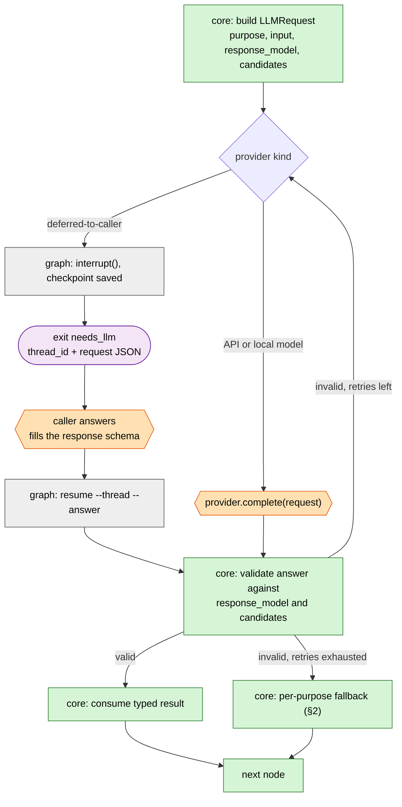

Rules that follow from the implementation design:

- **A resumed node re-runs from its start.** An LLM node has no side effects before its `interrupt()`. Writes and pushes happen only in later nodes.
- **The LLM never produces a value that `core` consumes unchecked.** An answer is one of three kinds (§2): prose that no logic reads, a selection among candidates that `core` generated, or a parse of free text into typed edits that `core` validates.
- **The exception is estimation** (nutrition, §3 G1): the one place LLM-produced numbers are stored. They are labelled as estimates and never feed the scheduler.

## 2. The LLM touchpoint catalog

This is the complete boundary: the only places an LLM is used. Anything not in this table is deterministic.

| # | `purpose` | Node | Kind | LLM receives | LLM returns | `core` checks afterwards | Fallback if no valid answer (**Proposed** except #2) |
| --- | --- | --- | --- | --- | --- | --- | --- |
| L1 | `classify_activity` | `reconcile_date` (R13 only) | Select | Note + that date's activities + the candidate actions from R2–R12 | One candidate id + reason | Id is in the candidate list; guards pass (never touch logged sets, never overwrite non-empty, destructive only via R10/R11) | Leave the date unreconciled; flag it in the summary |
| L2 | `weigh_wellness` | `decide_session_type` (borderline only) | Select | Rule trace + wellness snapshot | `proceed` \| `lighten` \| `rest` + reason | Value is one of the allowed outcomes; safety filters still apply after | Proceed, flag it, cap the AMRAP (architecture.md §7.1) |
| L3 | `pick_replacement` | `repair_session` (pools exhausted only) | Select | The violating element + exercise ids from the catalog filtered by movement pattern and equipment | One exercise id | Id is in the filtered list; equipment, injury and rotation validators pass | Fail the run and notify |
| L4 | `write_context_narrative` | `write_context_narrative` | Prose | Rule trace + training state + decision | The `> Context` paragraph | Length/format only. No logic reads the text. | Template filled from rule ids |
| L5 | `summarize` | `summarize` | Prose | Run log (writes, pushes, verification, reasons) | The daily summary | Format only | Template filled from the run log (see gap 7: could be the default) |
| L6 | `parse_feedback` | `apply_feedback` | Parse | Athlete's text + day state + the typed-edit schemas | `list[TypedEdit]` or `Unparsed(reason)` | Each edit validates against its own type: ranges, known equipment, allowed session types | Return to athlete as `unparsed`; change nothing |
| L7 | `choose_tm_bump` | cycle close-out in `bookkeeping` | Select | AMRAP result + the bump options `core` computed (standard, aggressive) | One option + reason | Option is one of the computed ones; athlete confirms (§3 C3) | Standard bump, per the rules |
| L8 | `rank_substitutions` | `substitutions search` | Select | Pattern + catalog hits, filtered by equipment | Ranked candidate ids | Ids are in the hit list; a human reviews before any registry entry is made | Unranked catalog hits |
| L9 | `parse_meal` (**deferred**) | `nutrition log` | Estimate | Meal text | `list[MealItem]` with kcal/protein/carbs/fat + confidence | Non-negative, kcal ≈ 4p + 4c + 9f within tolerance, sane ranges | Ask the user to restate |

**Never an LLM** (architecture.md §11): choosing the session type, computing weights/paces/volumes, picking accessories, picking Garmin substitutions, editing logged sets or deleting notes outside R10/R11, pushing without a passing verify.

**Provider kinds:** L1–L9 take any provider. A fourth, **Proposed**, kind is a `template` provider that always takes the fallback column. That makes a fully deterministic run possible (tests, `dry-run`, offline use).

## 3. Interaction catalog

Legend: **Py** = deterministic Python only. **L#** = LLM touchpoint from §2.

| ID | Interaction | Entry | Boundary summary |
| --- | --- | --- | --- |
| **A. Setup** | | | |
| A1 | Edit the config | Hand-edit YAML | Py (validated on the next command) |
| A2 | Validate config and adapters | `validate` | Py + port health checks |
| A3 | Swap a plugin, adapter, or LLM provider | Config edit | Py |
| A4 | First-time setup wizard (**future**) | `init` | Py |
| **B. Daily loop** | | | |
| B1 | Scheduled daily run | `run` | Py + ports; L1, L2, L3, L4, L5 |
| B2 | Run when a step fails | `run` | Py + ports; fallbacks |
| B3 | Re-run the same day (**Proposed**) | `run` | Py + ports |
| B4 | Caller answers an LLM request | `resume` | Py validate; the answer is the LLM |
| B5 | Reconcile on its own | `reconcile --days N` | Py + ports; L1 |
| B6 | Dry run | `dry-run` | Py + recording ports; template provider |
| B7 | Verify a pushed workout | `verify --date` | Py + `Device` read |
| **C. Feedback and data entry** | | | |
| C1 | Athlete feedback | `feedback --date D "<text>"` | L6, then Py |
| C2 | Report or resolve a symptom | `feedback` | L6, then Py |
| C3 | Confirm a TM bump | `feedback` | L7, Py |
| C4 | Log a result or benchmark (**Proposed**) | `feedback` or `log` | L6, Py |
| **D. Inspection** | | | |
| D1 | See today's plan or current state (**Proposed**) | `status` | Py only |
| D2 | Search for a substitution | `substitutions search` | Py; L8 optional |
| D3 | List or cancel pending LLM threads (**Proposed**) | `threads`, `cancel` | Py only |
| D4 | Read a run's audit log (**Proposed**) | `log --date` | Py only |
| **E. Implicit (the athlete never calls the system)** | | | |
| E1 | Completes the planned workout on the watch | next `run` | Py (R2–R9) |
| E2 | Does something other than planned | next `run` | Py (R10) |
| E3 | Skips the session | next `run` | Py (R11) |
| E4 | Two activities in a day | next `run` | Py (R12) |
| E5 | Edits a note by hand | next `run` | Py (Store parse) |
| E6 | Receives the notification | `Notifier` | Py |
| **F. Developer / operator** | | | |
| F1 | Write an adapter | code | contract tests |
| F2 | Write a plugin or program | code | fixture tests |
| F3 | Add a substitution entry | code/data | Py; D2 |
| F4 | Run the test suite or CI | `just check` | scripted provider, no network |
| **G. Nutrition (deferred)** | | | |
| G1 | Log a meal in natural language | `nutrition log` | L9, then Py |
| G2 | Correct or view meals | `nutrition …` | L9 (correct), Py (view) |

---

## A. Setup

### A1 · Edit the config

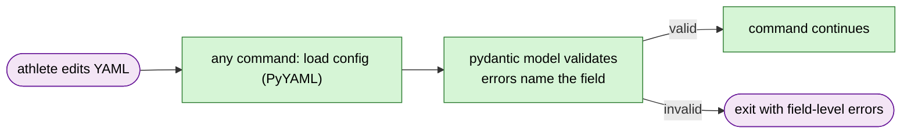

No LLM. Secrets never appear in the file; they come from the environment or the OS keychain.

### A2 · `validate`

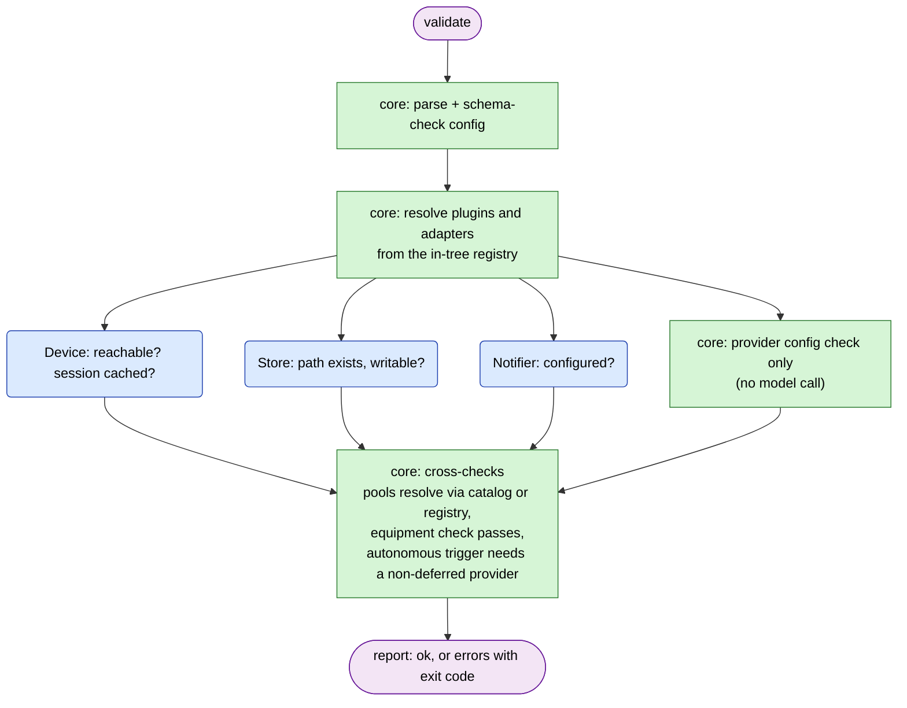

The cross-checks and the optional `--probe` (one trivial typed request to the configured provider) are **Proposed**. Without the probe there is no LLM call at all.

### A3 · Swap a plugin, adapter, or provider

Same flow as A1. Two things to know:

- The new setting applies to the **next** run. `LoopState.config` is checkpointed, so a thread that is already in flight resumes with the config it started with (see gap 8).
- Activation history is append-only. Swapping adds a row; it does not replace one.

### A4 · `init` wizard (future)

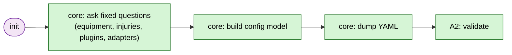

Deterministic. The wizard writes the same YAML a person would hand-edit.

---

## B. Daily loop

### B1 · Scheduled `run`

The main flow. Every hexagon can exit `needs_llm` when the provider is deferred (§1).

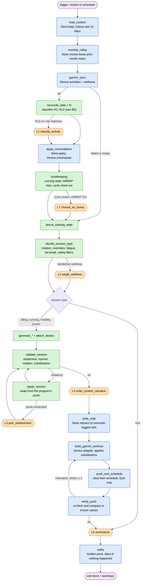

**What is deterministic here:** every decision that changes what you do today. Session type, lift, weights, paces, accessories, volumes, validation, the Garmin payload and its verification are all `core` or adapter code. **Where the LLM sits:** two prose steps (L4, L5) that explain a decision after it is made, and four conditional selections (L1, L2, L3, and L7 once a cycle) that are constrained to a list `core` produced.

**Rest day:** `route → summ`. No note is written and nothing is pushed.

**Normal day, deferred provider:** two round trips (L4 and L5). A day with an ambiguous activity, a borderline wellness call, or a cycle close-out adds one each.

### B2 · A step fails

Failure policy from architecture.md §12.

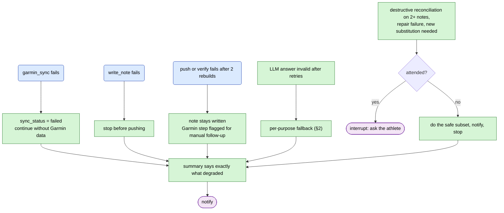

No new LLM use. Every failure path ends in a deterministic message.

### B3 · Re-run the same day (**Proposed**)

`thread_id = day-{date}`, so a second `run` lands on the same thread.

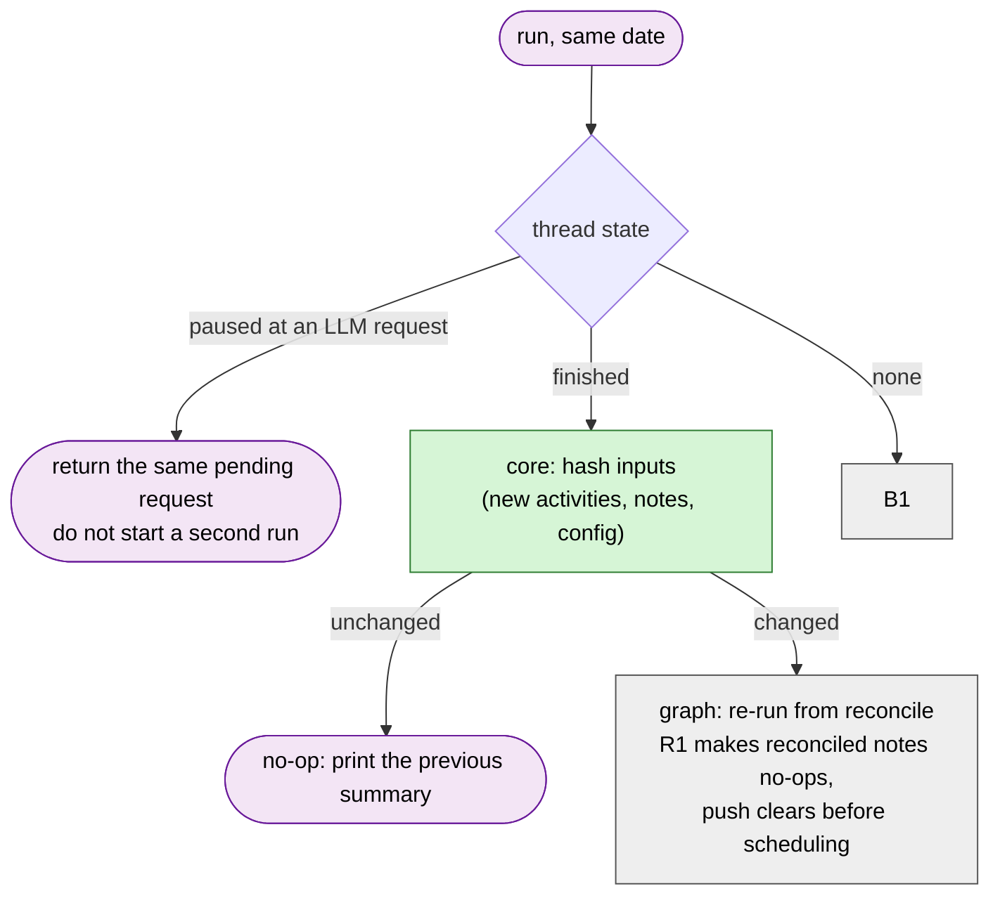

### B4 · `resume` (the caller answers)

This is the only point at which Claude's own reasoning is part of a run.

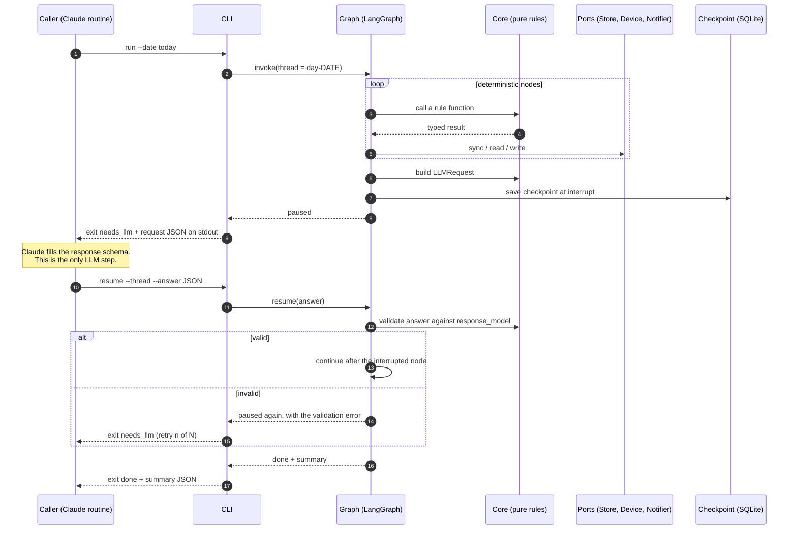

Autonomous mode removes the pause and resume (steps 8 to 11). The configured provider answers inside `G`, and the caller sees only `done`.

### B5 · `reconcile --days N`, and the classifier itself

B1's `reconcile_date` node, run on its own (**Proposed:** as a subgraph reusing the B1 nodes). The classifier is where the most rules and the narrowest LLM use meet.

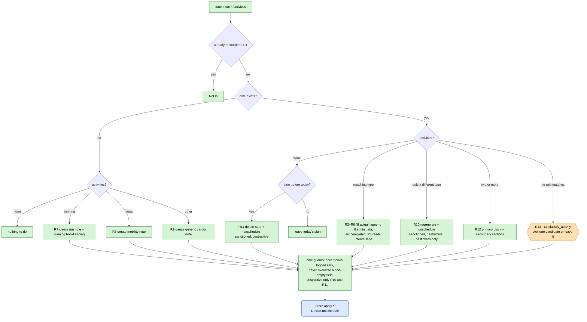

R1–R12 are deterministic. R13 hands the LLM a list of R2–R12 actions to choose from; it cannot invent an action.

### B6 · `dry-run`

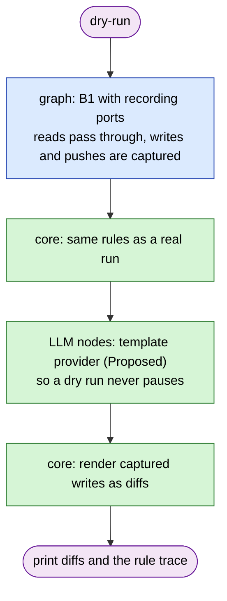

Open question (gap 6): a dry run on the deferred provider would stop at the first LLM node. Using the template provider keeps it fully deterministic, at the cost of not showing the real narrative.

### B7 · `verify --date`

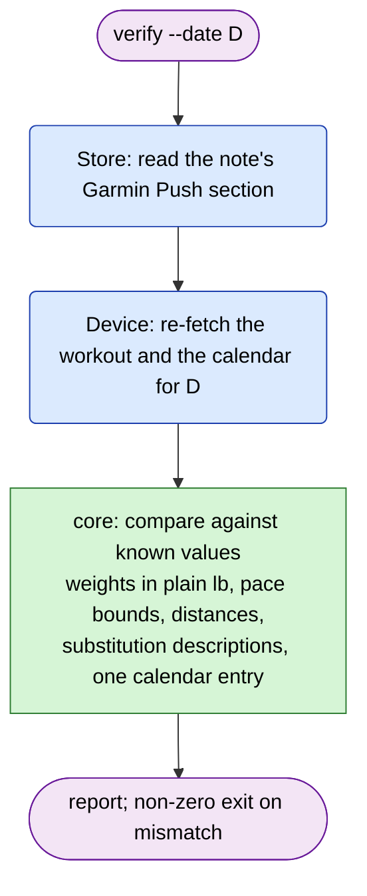

Read-only. A mismatch is reported, not repaired. Repair happens only in a `run`.

---

## C. Feedback and data entry

### C1 · `feedback --date D "<text>"`

The only place free text becomes a state change, so it is the most exposed point of the LLM boundary.

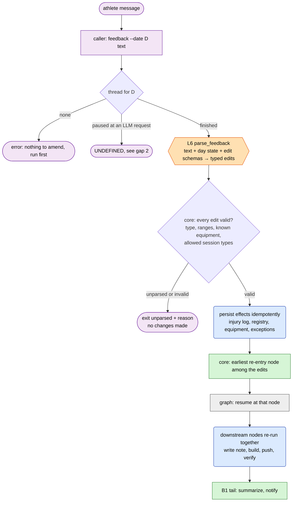

LLM touches only the parse. Persisting the effects, choosing the re-entry node, and everything downstream are deterministic. The re-entry point per edit type:

| Edit type | Example | Deterministic effect | Re-entry node |
| --- | --- | --- | --- |
| `OverrideSessionType` | "Make today running-only" | Override recorded in the note; rotation untouched | `decide_session_type` |
| `SkipPhase` | "Skip the deload" | Cycle History row; new TMs active | `bookkeeping` |
| `AdjustVolume` | "Bump the long run to 10K" | Logged as an exception, baseline not advanced; range-checked against the ceiling | `generate_running` |
| `SwapAccessory` / `SwapSession` | "Mobility instead of the recovery run" | Pool/rotation checks | `generate_*` |
| `ReportSymptom` | "Lower back fatigued" | Injury log row (append-only); restrictions active | `validate_session` |
| `ResolveSymptom` | "Back felt fine after" | Injury row marked resolved | `bookkeeping` |
| `ReportOffScript` | "Added a squat ramp" | Appended section; excluded from TM math | `apply_reconciliation` |
| `EquipmentCorrection` | "No cable machine" | Equipment/registry updated; re-push | `validate_session` |
| `SubstitutionCorrection` | "Dead bug isn't intuitive" | Registry entry updated with history comment | `build_garmin_workout` |
| `RoutineChange` | "Add supine twist" | Mobility routine and pose list updated | module config |

### C2 · Report or resolve a symptom

Same flow as C1 with the append-only injury log:

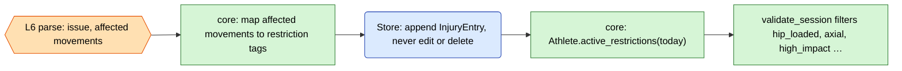

The LLM extracts what the athlete said. The restriction tags that follow are a fixed mapping in `core`, so the LLM does not decide what is unsafe.

### C3 · Confirm a TM bump

Architecture.md §11 has the LLM "suggest larger TM bumps", while its principle is that the LLM does not compute weights. This flow keeps both true by having the LLM choose between options that `core` computed.

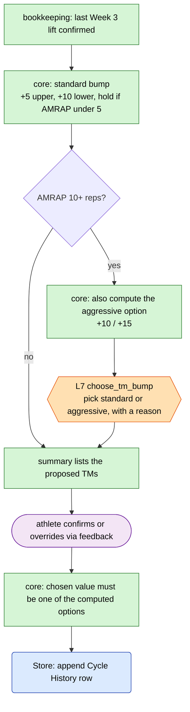

Open (gap 4): if the athlete never confirms, do the standard TMs apply?

### C4 · Log a result or benchmark (**Proposed**)

Benchmarks and self-reported values have no entry point today: the broad-jump test, a VDOT race result, bodyweight, energy, sleep.

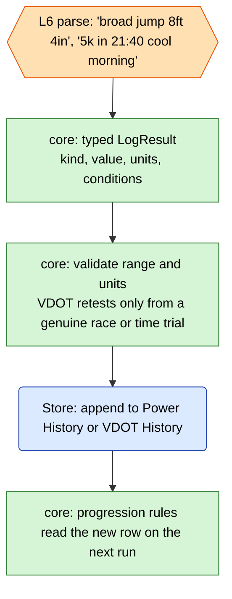

Needs a new edit type (`LogResult`) or a dedicated `log` command. See gap 3.

---

## D. Inspection

### D1 · `status` (**Proposed**)

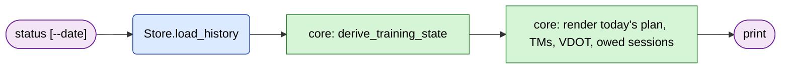

No graph and no LLM. The CLI calls `core` directly. Without this, a caller asking "what is my plan today?" would have to read vault files and bypass the `Store` port.

### D2 · `substitutions search <pattern>`

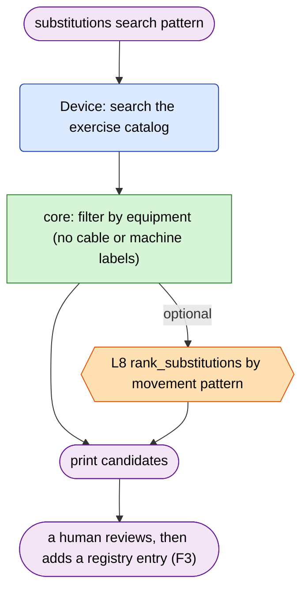

Candidates are never auto-picked.

### D3 · List or cancel pending threads (**Proposed**)

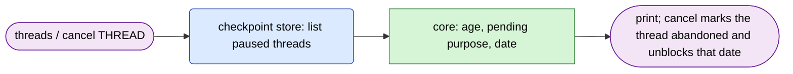

### D4 · Read a run's audit log (**Proposed**)

`log --date D` prints the per-run JSON log (rule trace, writes, Garmin calls). Deterministic and read-only.

---

## E. Implicit interactions

The athlete interacts with the watch and the vault, not the CLI. The system meets these at the next `run`.

### E1–E4 · Doing, changing, skipping, or doubling a workout

All four go through the classifier in B5.

| ID | What the athlete did | Rule | Destructive? |
| --- | --- | --- | --- |
| E1 | Completed the planned workout on the watch | R2–R6 | No |
| E2 | Did something other than planned (the golf case) | R10: regenerate, unschedule the stale entry, planned session re-enters the owed pool | Yes (sanctioned, past dates only) |
| E3 | Did nothing | R11: delete the note, unschedule, session re-enters the owed pool | Yes (sanctioned, past dates only) |
| E4 | Did two activities | R12 | No |

### E5 · Edits a note by hand

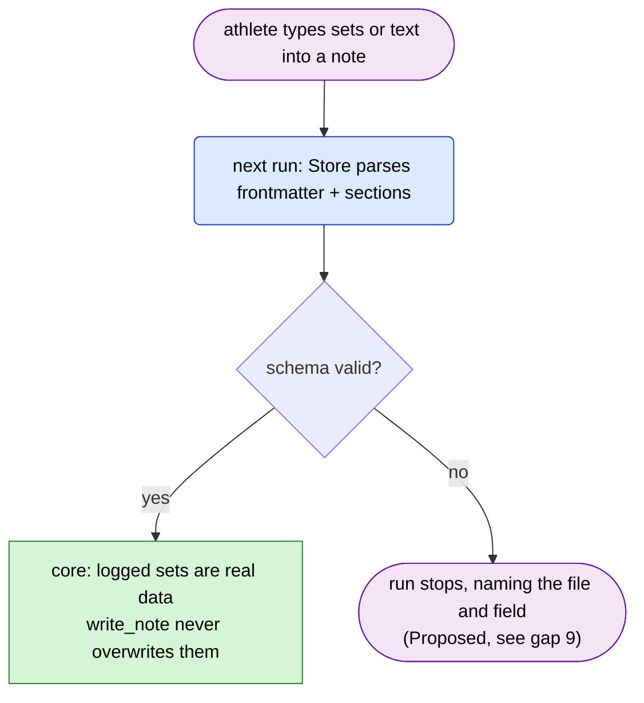

### E6 · Receives the notification

`Notifier.send(summary)` fires when something happened (session generated, a note reconciled, sync failed, verify failed) and stays silent otherwise. The summary comes from L5, or from the template fallback.

---

## F. Developer and operator

| ID | Interaction | Flow |
| --- | --- | --- |
| F1 | Write an adapter | Implement the port Protocol → run the port's contract suite against it and the in-memory fake → register in the adapter registry → reference by name in config → `validate` |
| F2 | Write a plugin or program | Implement `Discipline` → run the fixture suite → register in the in-tree registry → select in config (entry-point discovery later) |
| F3 | Add a substitution entry | D2 → pick by movement pattern → add the registry entry with its history comment → the contract test confirms the equipment check and the description rule |
| F4 | Run tests or CI | `just check` → scripted `LLMProvider` and in-memory ports → no network → the import-rule test enforces the layers |

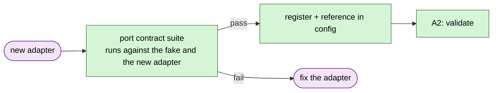

---

## G. Nutrition (deferred)

Standalone: the training `core` does not import it, and the scheduler never reads it.

### G1 · `nutrition log "<text>"`

```mermaid
flowchart TD
    classDef core fill:#d6f5d6,stroke:#2e7d32,color:#000
    classDef port fill:#dbeafe,stroke:#1e40af,color:#000
    classDef llm fill:#ffe0b2,stroke:#e65100,color:#000
    classDef human fill:#f3e5f5,stroke:#6a1b9a,color:#000

    A(["nutrition log text"]):::human --> L{{"L9 parse_meal<br/>items, quantities, kcal/P/C/F, confidence"}}:::llm
    L --> V["core: validate<br/>non-negative, kcal near 4P + 4C + 9F, sane ranges"]:::core
    V -->|"invalid"| X(["ask the user to restate"]):::human
    V -->|"valid"| W("Store: append MealEntry, flagged as an estimate"):::port
    W --> T["core: totals against daily targets"]:::core
    T --> O(["print entry, confidence, and running totals"]):::human
```

### G2 · Correct or view

- **View** (`nutrition summary --date D`): `Store` read → `core` aggregation → print. Deterministic.
- **Correct** (`nutrition log --correct ID "<text>"`): G1 again, replacing the entry. Keep the earlier revision so the log stays append-only.

---

## 4. Boundary summary

How much of each interaction is deterministic:

| Interaction | Python-only? | Where the LLM is, if anywhere |
| --- | --- | --- |
| A1–A4, B7, D1, D3, D4, E1–E6, F | Yes | — |
| B1 daily run | Core of it | Prose: L4, L5. Selections: L1, L2, L3, L7 (conditional) |
| B2 failure paths | Yes | Fallbacks only |
| B5 reconcile | R1–R12 | R13 → L1 |
| B6 dry-run | Yes, with the template provider | — |
| C1–C2 feedback | Everything after the parse | L6 |
| C3 TM bump | Options and final value | L7 |
| C4 log a result | Everything after the parse | L6 |
| D2 substitutions | Search and filter | L8 (optional) |
| G1–G2 nutrition | Validation, storage, totals | L9 |

## 5. What the LLM cannot do, by construction

- It cannot change anything alone. Every answer passes a `core` validator before it is used (§1).
- It cannot pick the session, the weights, the paces, the volumes or the accessories. No touchpoint receives them as a free choice.
- It cannot delete or overwrite logged data. The guards sit after L1 and apply to any action.
- It cannot reach the watch. The Garmin workout is built from the validated `Session` only; no LLM output, including the narrative, flows into it.
- **Untrusted text reaches it.** Activity names, note text and feedback go into prompts, so a hostile string could try to steer an answer. The control is that an answer is typed and checked. A selection must be in the candidate list, an edit must pass its own validator, and prose is never read by logic. Free-text fields should be passed to prompts as data, never concatenated into instructions.

## 6. Gaps and open questions found while drawing these flows

1. **No read-only queries.** The command list has no `status`/`show`. A caller asking "what's today's plan?" would read vault files directly and bypass the `Store` port. Proposed: D1.
2. **Feedback during a paused run.** Feedback and a pending `needs_llm` request share `thread_id = day-{date}`. Feedback arriving while the thread waits for an answer has no defined behavior. Options: reject it; queue it until the run finishes; or invalidate the pending request and fork from the re-entry node.
3. **No way to log results.** The broad-jump test, a VDOT race, bodyweight, energy and sleep have no entry point. Options: a `LogResult` edit type via `feedback`, or a `log` command (C4).
4. **TM bump confirmation.** If the athlete never confirms, do the standard TMs apply? Architecture.md §7.3 says new TMs take effect immediately.
5. **Abandoned threads.** If a `needs_llm` request is never answered, nothing expires it, and the next day's run may start with a stale thread. Needs expiry, and D3 (`threads`, `cancel`). Reconciliation of the missed day must still run.
6. **`dry-run` and the deferred provider.** A dry run would stop at the first LLM node. Proposed: the `template` provider (§2), which always takes the deterministic fallback.
7. **Is `summarize` worth an LLM?** It reports facts the run already holds. Making L5 a deterministic template by default would remove one round trip per day in Claude-mediated mode and one source of drift, keeping the LLM for L4. That moves a boundary the architecture doc currently puts on the LLM side.
8. **Config changes mid-thread.** `LoopState.config` is checkpointed, so a resumed thread keeps the config it started with. Decide whether that is desired and document it.
9. **Malformed notes.** If a hand-edited note fails the schema, options are to stop the run (safe, loud), or to skip the note (the rotation could then be wrong). Proposed: stop and name the file and field.
10. **Fallbacks beyond L2.** Only the borderline-wellness fallback is defined in the existing docs. The rest of the fallback column in §2 is new and needs your review.
11. **Autonomous trigger with the deferred provider.** A scheduled run with nobody to answer would stall forever. `validate` should reject that combination.
12. **Round trips.** A normal day costs two in Claude-mediated mode (L4, L5). Parallel reconcile branches can raise several `interrupt()`s at once; the CLI should return them as one batch rather than one per resume.
13. **`today` and time zones.** Which date a run belongs to (a run after midnight, a travelling athlete) is not defined.
